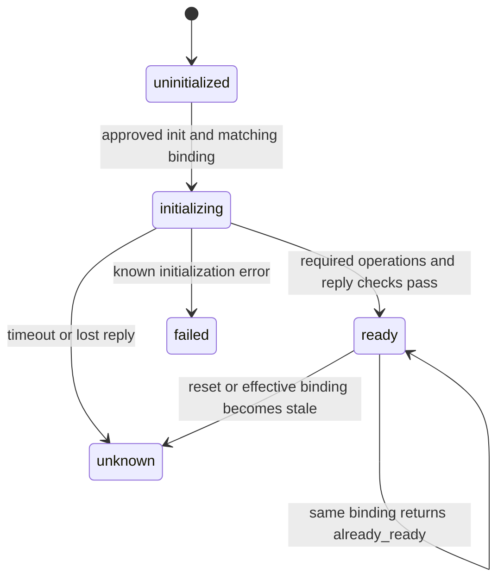

# Board capability: specialize drivers and initialize a target board

This is the skill's authoritative board-generation workflow. Its delivered projection is
`capabilities/board.md`, grouped by `board_id` and listing every bound device. It extends
**Board-Level** using the existing three device models; it is not a fourth device model.
The final package still exposes one public MCP service.

## Required inputs and scope

Before generating board glue or touching hardware, read the selected
[physical board profile](external/boards/), matching [HAL guidance](external/libraries/),
[interface requirements](external/interfaces/) and [circuit constraints](external/reference-circuit.md).
Bind the exact MCU/package, PCB revision, target SDK/project and toolchain. A family name,
board Markdown file or successful portable-driver test does not supply a target project.

Require these project inputs, with source references or explicitly identified user choices:

- Device IDs, canonical models and verified portable driver `.c`/`.h` artifact identities.
- Board revision, normal supply/logic domains, actual connector/pin/AF map and topology.
- Bus instances, addresses/CS, clocks and rates, I2C timing/filter inputs, SPI profiles,
  reset/IRQ ownership and shared-resource rules. Check every participant's operating limits.
  Bind the device's documented reset/enable pin and drive the documented reset sequence
  before init; an unbound reset leaves the device in its power-up state (for example
  LowVbat) and the first command NACKs.
- A complete clock/time-base plan, selected startup/vector/system support, linker memory
  map, HAL configuration, MSP/IRQ/DMA ownership and pinned/restorable vendor dependencies.
- The implemented control path: UART instance/pins/AF, baud/framing/flow control, protocol,
  endpoint identity and finite request/response limits, or another verified target backend.
- Requested source/native/target-build/hardware scope and explicit execution permissions.

Missing inputs block the affected specialization/init scope. Do not fill them with guessed
pins, clock frequencies, timing hex constants, successful stubs or an unrelated board's code.
No board requested means an explicit out-of-scope section in the generated `board.md`, not
invented firmware or registered no-op board tools. Knowledge-only conversion retains its
standalone output exception in [aggregation](aggregation.md).

For this project's NUCLEO-F103RB, read [NUCLEO-F103RB](external/boards/nucleo-f103.md) and
[STM32F1 HAL](external/libraries/f103_hal.md). The Arduino-header interfaces are:

- **I2C1:** PB8 (SCL) / PB9 (SDA), via AFIO remap (the default I2C1 pins are PB6/PB7).
  F1 uses `ClockSpeed`/`DutyCycle`, not G0 AF numbers or I2C `Timing`.
- **SPI1:** PA5 (SCK) / PA6 (MISO) / PA7 (MOSI), the default pins (no remap), plus software
  CS on PB6 (Arduino D10). PA5 doubles as the BSP LD2, so LED and SPI SCK use are not
  independent resources.

Use STM32CubeProgrammer through ST-LINK/SWD for authorized programming and ST-LINK Virtual
COM for serial I/O. The actual VCP UART instance/pins/baud, I2C remap, clock plan and device
SPI profiles are still required inputs; this profile does not claim a compiled F103 firmware.

## Specialization workflow

1. Validate the complete board/device binding. Resolve shared bus addresses, CS/pin ownership,
   voltage domains and effective pull-ups from the supplied topology. Reject incompatible
   or unresolved configurations before emitting a ready-to-build claim.
2. Reuse each device's exported portable driver unchanged. Generate real per-instance target
   adapter/context code implementing its HAL contract: I2C address conversion exactly once,
   documented combined transfers, complete SPI CS frames, real error mapping, bounded time
   and shared-bus ownership. Do not replace device algorithms or copy an independent
   implementation into the adapter.
3. Generate real `board_init.c/.h`, `device_hal.c/.h`, bootstrap/control implementation and a
   complete target project. Use the pinned vendor startup/linker/HAL inputs and required
   licenses. Keep application entry points and MCU headers out of the portable driver.
   Use static bounded buffers/contexts where suitable; do not introduce unnecessary MCU
   heap allocation. The existing profile's pseudocode is guidance, not a completed C file.
4. Compile the actual portable driver plus adapter/init paths in a deterministic native
   harness. Check address/CS isolation, initialization order, failed HAL operations,
   timeouts, idempotence and failure cleanup. Injected responses are native/model evidence,
   never physical observations. Keep the harness separate from production firmware.
5. Build/link the actual target firmware using the declared recipe. Inspect its memory map,
   entry/vector/startup, ABI and binary identity. Preserve build results; native compilation
   does not establish that an STM32 target image linked. Missing target SDK/compiler leaves
   target-build scope blocked, not silently satisfied by the native harness.
6. When authorized, program/verify the identified board, then exercise initialization and
   device operations through the actual implemented control path. For F103 follow
   [CubeProgrammer](external/tools/stm32cubeprogrammer.md),
   [ST-LINK](external/tools/stlink.md) and
   [UART/VCP handling](external/interfaces/uart.md). Flash verification, board initialization
   and correct sensor measurements are separate results.
7. Project actual bindings, artifacts and outcomes into `capabilities/board.md`; integrate
   the board tools into the existing single MCP entry. Recheck the extracted delivery.

`specialize_driver` produces/validates artifacts; it does not implicitly flash or initialize
hardware. `init` does not secretly build, install dependencies or program a new image.

## One public MCP, board-owned actions

Reserve `board__` for board tools; device ID `board` is reserved. Board and bound-device
IDs start with an ASCII letter/digit and use only ASCII letters/digits, `_` or `-`, without
`__`. Reject namespace collisions rather than renaming a device silently.
Each advertised board exposes these typed tools through root `agent_mcp.py`:

| Final tool name | Responsibility |
|---|---|
| `board__<board_id>__specialize_driver` | Specialize selected device drivers using the verified board binding; return real project/artifact paths, identities and validation scope |
| `board__<board_id>__init` | Initialize the matching firmware/board binding through the authorized implemented control path and return actual state/errors |
| `board__<board_id>__get_state` | Query binding/build/protocol identity and board state without reinitializing it |

Their registry records have `model: driver`, scenario `board-level`, `board_id` and
`board_action` (`specialize_driver`, `init`, `get_state`). Device tools retain
`<device_id>__<tool_name>`. Board tools are not separately registered client services.
Sources bind both board SDK/HAL procedures and the selected device operations.

The generation task implements these tools for its actual target/backend. Merely returning
`attach_board` metadata, copying a Markdown profile, reporting a file path without the file,
or unconditionally returning `ready` is not this capability.

## Bootstrap and initialization state

A VCP request cannot arrive until the target's control UART is usable. Split cold-boot
bootstrap (HAL/time base, verified system clock and control UART) from the requested bus/
board initialization. Do not reconfigure the live control UART while replying to an init
command. Source the actual reset, GPIO/RCC and peripheral sequence from the target project.

- Verify board, protocol, embedded build ID and binding identity before accepting readiness.
  The host ties the build ID to the exact programmed image/hash; do not pretend firmware
  can embed the hash of its own final ELF without a defined non-circular scheme.
- Exercise the control protocol's verb parser/dispatcher behaviorally, not just compile it:
  at minimum a per-verb round-trip (e.g. `PING` → an expected `PING ...` reply) against the
  built firmware or a UART loopback. A passing target build proves the code compiles, not that
  parsing/dispatch is correct — a wrong helper return type (such as a character transform
  declared `bool`) compiles cleanly yet misroutes every verb.
- Run safe CS/GPIO, required buses, filters and finite-time transport setup once per owned
  board lifecycle. Sensor-specific startup remains the device driver's responsibility.
- Repeated init for the same ready binding returns `already_ready` without resetting active
  devices. A changed binding or conflicting active request returns a busy/rebuild-required
  error, not an in-place peripheral reconfiguration under another device.
- On failure keep owned CS safe, quiesce only acquired resources, retain the failing stage/
  HAL status and never set ready. An uncertain timeout is `unknown`; no blind retry of
  side-effecting initialization. Recovery requires an explicit owned procedure.
- One board/probe/COM owner serializes reset/programming/init, and one parser routes all
  device replies. Hold bus ownership across complete transactions. Use bounded frames,
  explicit operation/device/request identity and faithful target error reporting.
- Native/model state is labeled with its backend and `physical: false`. Only a real matching
  hardware acknowledgement can establish physical readiness. Ready does not prove sensor
  accuracy, electrical timing or calibration. No physical work is authorized by installing
  the skill or connecting MCP.

## Canonical binding and delivered files

Use `boards/<board_id>/board.json` as the canonical board/project binding, separate from
per-device model facts. Generate `capabilities/board.md` from it and the bound device models.
The board package contains real init/adapter/header/bootstrap/control/startup/linker/build
sources and declared dependencies under `boards/<board_id>/firmware/`, internal board tool
code when needed, and built firmware artifacts under `boards/<board_id>/artifacts/`.
Do not ship test fakes or depend on an undeclared development workspace.
The APP (control) firmware — `main.c`, `control.c/.h`, `board_binding.h` — follows
[app/specification.md](app/specification.md) and is recorded as the `app_source`,
`control_source`, `control_header` and `binding_header` artifacts.

Root `BOARD_CAPABILITIES` maps each board ID to its root-relative `board.json`. Schema 1 has:

| Field | Required content |
|---|---|
| `schema`, `board_id`, `sources` | Version `1`, exact board ID and nonempty source-reference list |
| `binding` | `profile_id`, `board_revision`, `mcu`; nonempty `pins`, `clocks`, `buses`, `control`; `hal_sha256`, `plan_sha256`; selected `devices` |
| `binding.devices` | Per device: `device_id`, delivered `driver_root`, `driver_files` relative to that root, stable `driver_sha256`, `bus_id`, and applicable address/CS/configuration |
| `binding_sha256` | Stable digest of the binding only, computed as below |
| `tools` | Exact names for `specialize_driver`, `init`, `get_state` and their board/action registry metadata |
| `artifacts` | Unique root-relative `{role, path, sha256}` records for real files |
| `evidence` | Separate `target_build` and `hardware_init` results, with statuses and actual provenance |

Hash the UTF-8 encoding of `json.dumps(binding, sort_keys=True, ensure_ascii=False,
separators=(',', ':'), allow_nan=False)` with SHA-256 and no final newline. Exclude output
hashes, reports and bookkeeping from that binding to avoid self-reference. Portable driver
artifact-set hashing follows [feedback](datasheet2mcp/references/feedback.md); specializing
only HAL glue must not change portable driver bytes or their hash.

Require artifact roles `init_source`, `init_header`, `hal_source`, `hal_header`,
`build_recipe`, `startup`, `linker`, `app_source`, `control_source`, `control_header`,
`binding_header`. A passed target build also requires
a `firmware` artifact and toolchain identity. A passed hardware initialization additionally
requires a passed target build, `physical: true`, `state: ready`, matching board/binding/
firmware identities and an observation reference. Failed/not-run records have reasons;
they do not count as build or hardware passes.

All file references stay inside the delivered root (driver-file references inside their
own driver root); reject absolute/traversal/symlink escapes and stale hashes. SDK installation
may be separately documented at a pinned revision, but all claimed generated project files
must actually exist. See [runtime verification](datasheet2mcp/references/runtime-verification.md)
for executable manifest checks and their limits.

## Generated `capabilities/board.md`

For each board include:

- Requested/supported/blocked scope and exact missing inputs, board revision/MCU and sources.
- Device/driver identities; complete pin/net/bus/address/CS bindings and operating constraints.
- Clock/time-base, I2C Timing/filter, SPI profiles and VCP/UART/protocol configuration.
- Bootstrap/init sequence, error states, ownership, idempotence and recovery boundaries.
- Actual generated source/project/build/firmware paths, dependencies and licenses.
- Unified MCP tool names and explicit authorized build/program/serial instructions.
- Binding/HAL/plan/build/firmware identities and source/native/target/QEMU/hardware outcomes.
- Failures, limitations, unperformed checks and effects of refinement on affected devices.

This output is not a replacement for `driver.md`, `designer.md` or `feedback.md`: those
record portable device operations, circuit design and calibration audit respectively.
Board specialization owns target glue and board-wide lifecycle.

## Refinement and completion

Refine may run before or after integration against the same device stores. Recompute only
affected board bindings/artifacts when emitted driver, HAL, pins, clocks or other firmware
inputs change. Mark old readiness/build/hardware evidence stale; rebuild, reflash and
reinitialize affected physical scope when required. Preserve other devices' facts, but
revalidate shared firmware/bus consequences. No-op regeneration, relocation, pure gateway
integration and unrelated knowledge edits do not change driver content hashes.

Run source review, native adapter/init checks, real target build and unified MCP routing/
state tests. Require physical init only when that scope is requested, with its actual board
and authorization. Verifier metadata success with `not_run` evidence is not target/hardware
acceptance. Missing requested target inputs or build/hardware prerequisites means partial
board delivery; never label pseudocode or no-op hooks as completed specialization.
