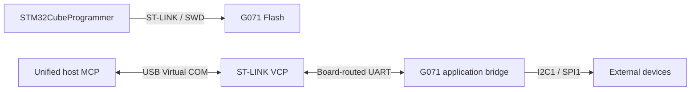

# NUCLEO-G071RB: physical board binding

Use this profile for an **STM32G071RB** target project or an explicitly authorized real-board
plan. It does not make a G071 interchangeable with an F103/F767, establish external wiring,
or declare a supported QEMU machine.

For requested driver specialization or executable board initialization, **read and follow
the [board capability](../../board.md) and [G071 HAL guide](../libraries/g071_hal.md) first**.
This profile supplies binding inputs and pseudocode, not completed board firmware; the
capability requires actual adapter/init/target-project sources and scoped build evidence.

## Identity and revision limits

| Item | Sourced baseline |
|---|---|
| Order code / PCB family | **NUCLEO-G071RB / MB1360**; not NUCLEO-G070RB or G0B1RE |
| MCU / CPU | **STM32G071RBT6**, LQFP64, Arm Cortex-M0+ |
| User I/O | Green user **LD4 on PA5**; **B1 on PC13**; separate NRST reset button |
| Expansion | ARDUINO Uno V3-compatible and ST morpho connectors |
| Debug | Embedded **ST-LINK/V2-1**, SWD and virtual COM functions |
| Working rails | Normally USB 5 V into the board power path and a regulated **3.3 V target domain**; external VIN **7–12 V** only with the documented selection/current/thermal constraints |

Primary references:
[UM2324, STM32 Nucleo-64 boards (MB1360), Rev 5](https://www.st.com/resource/en/user_manual/um2324-stm32-nucleo64-boards-mb1360-stmicroelectronics.pdf),
[ST board product page](https://www.st.com/en/evaluation-tools/nucleo-g071rb.html),
[MB1360-G071RB C02 schematic](https://www.st.com/resource/en/schematic_pack/mb1360-g071rb-c02_schematic.pdf),
and [ST G0 Nucleo BSP header](https://github.com/STMicroelectronics/stm32g0xx-nucleo-bsp/blob/main/stm32g0xx_nucleo.h).
The schematic is explicitly **C02**; no connected-board revision is known here.
Capture the actual silkscreen/assembly revision, MCU marking, solder bridges, jumpers,
oscillator population and modifications, then use the matching drawing. A generic G0
BSP or this manual's other order codes are not evidence of identical routing.

LD4 is not the F103's LD2. The official G0 BSP uses PC13 with **EXTI4_15_IRQn**, not the
F1/F7 PC13 interrupt grouping. The BSP's optional shield definitions do not establish
project wiring. Boot selection is MCU/revision-specific: do not assume a BOOT0 jumper or
change boot/option-byte configuration as part of a normal pin-map setup.

## Required board, bus and probe records

- **Pin map:** retain connector designator/contact, net name, MCU pin, peripheral
  instance and **G071 alternate-function number**, direction/pull/idle level and actual
  external-device contact for every signal. Verify schematic bridge settings and connector
  orientation. PA5 is also the BSP SPI1 SCK pin; do not allocate it independently to LD4
  and a sensor clock. Check debug, UART and oscillator nets for similar conflicts.
- **Electrical map:** name each supply and ground, bus pull-up rail, level shifter and
  shared-net loading. Board VIN/5 V are not GPIO voltage permissions. The G071 MCU's
  normal supply range is **1.7–3.6 V**, with conditions in the
  [STM32G071x8/xB datasheet](https://www.st.com/resource/en/datasheet/stm32g071rb.pdf);
  this does not authorize feeding that whole range into a board input or every peripheral.
  Do not use absolute maxima or blanket “5 V tolerant” claims as operating specifications.
- **Bus map:** identify initialized HAL handle, G071 peripheral instance, kernel clock,
  pin AFs and configured timing/mode. Store unshifted 7-bit I2C addresses per device;
  store SPI CS port/pin/polarity per device. A connector's Arduino label does not
  initialize a bus, resolve duplicate addresses or supply missing pull-ups.
- **Probe/power map:** bind a specific probe serial/firmware, target SWD/reset wiring,
  reference voltage, power-source/jumper configuration and board identity. Follow UM2324
  for USB versus external supply sequencing and available current; account for regulator
  dissipation and attached devices. Do not connect competing sources or assume the probe
  powers an externally wired target. Reconfiguring embedded ST-LINK for another target
  requires the manual's isolation and connector procedure.

## Project-selected I2C / SPI pins

The following is the **user-specified wiring for this project**, not a universal Nucleo
default. Keep it in the board binding; do not silently substitute another valid pin map.
Record the fitted PCB revision, connector/contact and solder bridges alongside it.

| Bus | Signal | MCU pin | Alternate function | Configuration / conflict |
|---|---|---|---|---|
| I2C1 | SCL | PB8 | `GPIO_AF6_I2C1` | AF open-drain **+ `GPIO_PULLUP`** (no on-board external pull-up) |
| I2C1 | SDA | PB9 | `GPIO_AF6_I2C1` | AF open-drain **+ `GPIO_PULLUP`**; review address straps and other pin users |
| SPI1 | SCK | PA5 | `GPIO_AF0_SPI1` | Shares PA5 with LD4; resolve GPIO ownership and LED loading |
| SPI1 | MISO | PA6 | `GPIO_AF0_SPI1` | Controller input; target must release it when deselected |
| SPI1 | MOSI | PA7 | `GPIO_AF0_SPI1` | Controller output; verify target input voltage domain |
| SPI1 | CS for the selected target | PB0 | GPIO output; software NSS | Set the device's documented inactive level before enabling transfers |

The project chooses PB8/PB9 and PB0. ST's
[G071 GPIO alternate-function data](https://github.com/STMicroelectronics/STM32_open_pin_data/blob/master/mcu/IP/GPIO-STM32G07x_gpio_v1_0_Modes.xml)
maps PB8 to I2C1_SCL and PB9 to I2C1_SDA, both AF6. The SPI signal mappings are also
defined by `NUCLEO_SPIx_*` in the
[official G0 BSP header](https://github.com/STMicroelectronics/stm32g0xx-nucleo-bsp/blob/main/stm32g0xx_nucleo.h).
PB0 is used here as a software-controlled CS, not assumed to be a hardware NSS AF.
For additional conventional SPI targets on the same bus, assign separate reviewed CS
GPIOs; do not select every target together with PB0.

Record the selected release/commit and actual header contacts from the matching board
schematic; no Arduino or morpho contact numbering is assumed here. Select CS polarity
from the device datasheet, not from its pin number.

The NUCLEO-G071RB has **no external pull-up on PB8/PB9** (Arduino D15/D14), so configure
the I2C pins with the internal pull-up (`GPIO_PULLUP`), never `GPIO_NOPULL` — a floating
bus fails with arbitration-lost (`HAL_I2C_ERROR_ARLO`, verified in practice). The weak
internal pull is adequate only for this low-capacitance, low-speed HTU21D bus; for a loaded
or faster bus, calculate external pull-ups per [I2C guidance](../interfaces/iic.md). In
general internal GPIO pulls do not establish adequate I2C pull-ups. For SPI,
not calling `BSP_LED_Init()` prevents software GPIO reconfiguration but does not remove
the physical LD4 load from PA5. Review that load/routing or select another separately
verified SCK mapping. Do not silently disable SWD or repurpose another occupied pin.

## VCP / control UART binding

ST-LINK Virtual COM is the board's fixed application serial path. The v0.1 G071 baseline
(`v0.1/examples/g071-sht40/firmware-sdk/bsp/board_init.c`) uses the standard NUCLEO-64 VCP
routing:

| Item | Value |
|---|---|
| UART | USART2 |
| TX | PA2, `GPIO_AF1_USART2`, AF push-pull, no pull |
| RX | PA3, `GPIO_AF1_USART2`, AF push-pull, no pull |
| Baud | 115200, 8 data bits, 1 stop bit, no parity, no flow control |
| Clock source | `RCC_USART2CLKSOURCE_PCLK1` |

This is a board-fixed routing, not a device parameter. Verify it against the fitted PCB
revision (UM2324 / schematic) before flashing; the presence of a USB COM port alone does not
prove these MCU pins. The control firmware must initialize USART2 and keep it stable while
replying to `board__<board_id>__init`.

## TIM2 / input-capture pins

TIM2 is a 32-bit general-purpose timer with four capture/compare channels and input-capture
mode (RM0444 §21). In the documented 56 MHz profile (APB1 prescaler = 1) its kernel clock is
PCLK1 = 56 MHz.

| Signal | MCU pin | Alternate function | Use |
|---|---|---|---|
| TIM2_CH1 | PA0 | `GPIO_AF2_TIM2` | input capture / output compare / PWM; also usable as plain GPIO |
| TIM2_CH2 | PA1 | `GPIO_AF2_TIM2` | input capture / output compare / PWM; also usable as plain GPIO |

Source: official ST G071 GPIO alternate-function data — PA0 → TIM2_CH1 AF2, PA1 → TIM2_CH2 AF2.

Timer guidance: follow the [TIM2 HAL section](../libraries/g071_hal.md) for the documented
`HAL_TIM_*` input-capture workflow — RCC timer-clock enable, GPIO AF2, prescaler/period
derivation, `HAL_TIM_IC_ConfigChannel` / `HAL_TIM_IC_Start(_IT)`, NVIC `TIM2_IRQn` and the
capture/period callbacks. Build prerequisite: the bundled SDK ships the TIM header but not
`stm32g0xx_hal_tim.c`; add that source and enable `HAL_TIM_MODULE_ENABLED` before building.
Capture timing is board-level evidence, not a device register fact.

## ADC1 / DAC1 (analog)

ADC1 is a 12-bit SAR ADC with channels IN0…IN18 (see datasheet pin table for bonded pins)
plus internal temperature / VREFINT / VBAT channels; resolution is selectable 6/8/10/12 bits.
DAC1 is a 12-bit dual-channel DAC.

| Analog function | MCU pin | Shared with |
|---|---|---|
| ADC1_IN0 / IN1 | PA0 / PA1 | TIM2_CH1 / CH2 (AF2) |
| ADC1_IN2 / IN3 | PA2 / PA3 | USART2_TX / RX (VCP) |
| ADC1_IN4 / DAC1_OUT1 | PA4 | analog only |
| ADC1_IN5 / DAC1_OUT2 | PA5 | SPI1_SCK (AF0) and LD4 — resolve ownership |
| ADC1_IN6 / IN7 | PA6 / PA7 | SPI1_MISO / MOSI (AF0) |
| ADC1_IN8 / IN9 / IN10 | PB0 / PB1 / PB2 | PB0 is the project SPI CS |
| ADC1_IN11 / IN15 / IN16 | PB10 / PB11 / PB12 | — |
| ADC1_IN17 / IN18 | PC4 / PC5 | TIM2_CH1 / CH2 (AF2) |

Reference and limits: ADC/DAC are analog, not 5 V-tolerant digital GPIO — signal and reference
must stay within VREF+ (or VDDA). Configure these pins `GPIO_MODE_ANALOG` + `GPIO_NOPULL` (no
alternate function). ADC clock, sampling time and DAC output are board-level; follow the
[ADC/DAC HAL section](../libraries/g071_hal.md). The bundled SDK ships the headers but not the
HAL `.c` sources; add `stm32g0xx_hal_adc.c` / `stm32g0xx_hal_dac.c` (and `_ex`) and enable
`HAL_ADC_MODULE_ENABLED` / `HAL_DAC_MODULE_ENABLED`.

## `board_init` pseudocode

This describes **MCU-side shared board initialization**, not a host Python function,
complete C implementation or tested firmware. Helper names express project responsibilities,
not additional STM32 HAL APIs supplied by this repository. Materialize them using the
pinned HAL, verified clock/pin configuration and [G071 HAL guide](../libraries/g071_hal.md).

This is a cold-start sketch. A VCP-triggered init must split control bootstrap from bus
initialization: the control UART must already work before the command arrives and must
not be reconfigured while sending its reply. Implement the lifecycle in [board.md](../../board.md),
including same-binding idempotence and failure/unknown states, rather than copying this
sketch as a complete runtime command.

`cfg` must include enabled buses, verified pins/AFs, normal voltage domains, clock/kernel
clock inputs, calculated I2C `Timing` and filter settings, complete HAL init fields,
SPI mode/word order/size/prescaler, per-device CS/reset bindings, and finite deadlines.
Optional TIM2 input capture uses PA0/PA1 (AF2) with prescaler/period derived from the 56 MHz
PCLK1 per [G071 HAL](../libraries/g071_hal.md).
For this project's ST-LINK Virtual COM route, bind the VCP UART from the table above
(USART2 PA2/PA3, AF1, 115200 8N1) plus the control protocol identity.
Use the project-selected map above; a changed pin map needs an explicit updated binding.

```text
board_init(cfg) -> Result<BoardContext, InitError>:
    validate board revision, wiring, power domains, clocks and pin ownership
    validate I2C pull-ups/timing inputs, SPI profiles and resolved PA5/LD4 use
    reserve shared board configuration; reject reinit while devices are active
    ctx = BoardContext(ready = false)
    try:
        check HAL_Init()
        check configure_system_clock_and_timebase(cfg.clocks, cfg.init_deadline)
        enable clocks for every selected GPIO port, including CS/reset ports

        if cfg.spi1.enabled:
            require the selected primary target's CS binding is PB0
            for each configured SPI1 target:
                preload its CS output latch to the documented inactive level
                configure its reviewed CS GPIO output and safe startup pull state

        if cfg.i2c1.enabled:
            ctx.i2c1 = I2C1 handle with every required Init field from cfg.i2c1
            check HAL_I2C_Init(ctx.i2c1)
            # MSP owns RCC kernel-clock selection, GPIO and peripheral clocks.
            # Project mapping: PB8/PB9, AF6, AF open-drain.
            check HAL_I2CEx_ConfigAnalogFilter(ctx.i2c1, cfg.i2c1.analog_filter)
            check HAL_I2CEx_ConfigDigitalFilter(ctx.i2c1, cfg.i2c1.digital_filter)

        if cfg.spi1.enabled:
            ctx.spi1 = SPI1 master handle with complete cfg.spi1 Init fields
            # Software NSS; PB0 is GPIO CS, not an alternate-function NSS pin.
            check HAL_SPI_Init(ctx.spi1)
            # MSP owns GPIO/peripheral clocks; PA5/PA6/PA7 use AF0 here.
            # Configure GPIO pulls/speed from the reviewed electrical plan.

        if cfg.vcp_uart.enabled:
            ctx.vcp_uart = selected UART handle with complete cfg.vcp_uart Init fields
            check HAL_UART_Init(ctx.vcp_uart)
            # MSP supplies the clock/pins/AF matching the board's ST-LINK VCP routing.
            attach one bounded receiver/parser and checked transmit path to ctx

        if cfg.tim2_capture.enabled:
            ctx.tim2 = TIM2 handle with complete base + IC Init fields from cfg.tim2_capture
            check HAL_TIM_Base_Init(ctx.tim2)
            check HAL_TIM_IC_Init(ctx.tim2)
            # MSP owns RCC TIM2 clock + GPIO; PA0/PA1 use AF2 (TIM2_CH1/CH2).
            check HAL_TIM_IC_ConfigChannel(ctx.tim2, &cfg.tim2_capture.ic, cfg.tim2_capture.channel)
            attach one capture/overflow callback with finite deadlines to ctx
            # Capture start is a separate owning-device action, not part of board init.

        attach bus/UART/timer handles, shared-resource locks and finite-time callbacks to ctx
        ctx.ready = true
        return Ok(ctx)
    on any failed check:
        keep owned CS outputs inactive; quiesce only resources acquired by this attempt
        keep ctx.ready false
        return InitError(failed_step, HAL_status, peripheral_error_if_available)
    finally:
        release the board-configuration reservation if still held
```

`check` means propagate a non-success status, not loop forever in `Error_Handler`.
Void GPIO/RCC operations need reviewed configuration and, where applicable, register or
physical checks; they are not HAL status-returning calls. MSP callbacks must implement
the selected RCC/GPIO setup exactly once, not duplicate conflicting setup in `board_init`.
Clock waits and transfers need a progressing time base and finite limits; host-side
deadlines alone cannot unhang MCU code.

Run board initialization once per owned board lifecycle, not once per device tool call.
Then bind each portable driver to its own address/CS/context and execute that device's
documented startup/configuration sequence. Reapply any per-device SPI profile under the
shared bus lock before its transaction. `ctx.ready` means board setup completed, **not**
that attached devices, electrical timing or measurement accuracy passed.
Opening a host MCP connection does not execute this routine automatically: an implemented
bridge/firmware command must provide the declared behavior. Changing this initialization
changes the effective HAL/firmware identity and requires affected revalidation.

## Selected system clock profile

Use the existing v0.1 G071 baseline (`v0.1/examples/g071-sht40/firmware-sdk/bsp/board_init.c`)
as the working reference; its values match ST's official
[NUCLEO-G071RB Templates.ioc](https://github.com/STMicroelectronics/STM32CubeG0/blob/master/Projects/NUCLEO-G071RB/Templates/Templates.ioc).

| Item | Value | Result |
|---|---|---|
| Source | HSI 16 MHz, `HSIDiv = RCC_HSI_DIV1` | 16 MHz PLL input |
| PLL source | `RCC_PLLSOURCE_HSI` | |
| PLLM | `RCC_PLLM_DIV4` | VCO input 4 MHz |
| PLLN | `70` | VCO 280 MHz |
| PLLR | `RCC_PLLR_DIV5` | SYSCLK 56 MHz |
| PLLQ | `RCC_PLLQ_DIV5` | 56 MHz |
| PLLP | `RCC_PLLP_DIV10` | 28 MHz |
| SYSCLK / HCLK / PCLK1 | `RCC_SYSCLK_DIV1`, `RCC_HCLK_DIV1` | 56 MHz |
| Flash latency | `FLASH_LATENCY_2` | required for 56 MHz in voltage scale 1 |
| Voltage scale | `PWR_REGULATOR_VOLTAGE_SCALE1` | set before PLL |

Configure in this order, checking each HAL status and propagating failure (never an infinite
`Error_Handler`):

```c
HAL_PWREx_ControlVoltageScaling(PWR_REGULATOR_VOLTAGE_SCALE1);
/* RCC_OscInitStruct: HSI on, HSIDiv DIV1, PLL on (HSI, M=4, N=70, P=10, Q=5, R=5) */
HAL_RCC_OscConfig(&RCC_OscInitStruct);
/* SYSCLK=PLL, HCLK/1, PCLK1/1 */
HAL_RCC_ClockConfig(&RCC_ClkInitStruct, FLASH_LATENCY_2);
```

56 MHz is the reference template target, not a universal requirement; any change alters
every kernel-derived timing value. I2C1 `Timing` and USART baud must be derived from the
**actual** 56 MHz kernel clock, electrical rise/fall assumptions and configured filters.
Do not copy the v0.1 recorded `I2C1.Timing` hex constant (for example `0x00303D5B`) across
boards or clock changes; follow [G071 HAL](../libraries/g071_hal.md). SysTick/HAL tick
derives from HCLK and must remain the progressing time base the HAL `timeout` arguments use.

## Arm GNU GCC build

Reuse the v0.1 CMake recipe (`v0.1/examples/g071-sht40/firmware-sdk/`); it compiles with the
Arm GNU Toolchain, not the bundled native compiler.

- **Toolchain:** `arm-none-eabi-gcc` (and `arm-none-eabi-as`), configured through a CMake
  toolchain file with `CMAKE_SYSTEM_NAME Generic`,
  `CMAKE_SYSTEM_PROCESSOR cortex-m0plus` and the recorded absolute compiler paths. Record
  the actual version and machine path in evidence; v0.1 recorded
  `D:/App/arm-none-gcc/bin/arm-none-eabi-gcc.exe` — that is machine-specific, not a portable
  default. Never auto-install a toolchain or modify `PATH`.
- **Defines:** `STM32G071xx`.
- **C flags:** `-mcpu=cortex-m0plus -mthumb -ffunction-sections -fdata-sections -fno-common`.
  Cortex-M0+ has no hardware FPU; do not add `-mfpu`/`-mfloat-abi` flags.
- **ASM flags:** `-mcpu=cortex-m0plus`.
- **Link flags:** `-mthumb -mcpu=cortex-m0plus -Wl,--gc-sections -T…/STM32G071RBTX_FLASH.ld`.
  The linker script places FLASH at `0x08000000` (128 KiB) and RAM at `0x20000000` (36 KiB).
- **Sources (v0.1 baseline):** `startup_stm32g071xx.s`, `system_stm32g0xx.c`, `board_init.c`,
  target `main`/application/device driver sources, plus the selected HAL modules — core,
  cortex, GPIO, EXTI, I2C(+EX), DMA(+EX), RCC(+EX), FLASH(+EX), PWR(+EX), UART(+EX) — as
  actually used by the project. Do not compile unused vendor modules into the image.
- **Output:** link `build/<project>.elf`; use `arm-none-eabi-objcopy` for a binary only when
  the programming path needs it, and review `arm-none-eabi-size`/link-map memory usage before
  flashing. An ELF in range does not by itself prove correct startup or peripheral behavior.

Building/executing generated firmware requires explicit `--allow-code-execution` or the host
equivalent. Compilation is a target-build step; it is distinct from flashing (via
[STM32CubeProgrammer](../tools/stm32cubeprogrammer.md)) and from any physical run. See
[GCC guidance](../tools/gcc.md) for error/evidence handling.

## G071 target assembly and host access

Use a pinned [STM32CubeG0](https://github.com/STMicroelectronics/STM32CubeG0) release and
record actual HAL/CMSIS/BSP commits and hashes from its
[component inventory](https://github.com/STMicroelectronics/STM32CubeG0/blob/master/.gitmodules).
Select **STM32G071xx** CMSIS/startup/system support, a linker script for the fitted G071RB
memory map, Cortex-M0+/Thumb code and a compatible non-FPU ABI. Record compiler/linker
versions, startup/vector/IRQ files, HAL configuration, linker script and generated project
configuration. F1 startup, F1 remap macros, F7 floating-point options and F103 linker
scripts are not substitutes.

Supply the board-specific clock, GPIO/AF, MSP, interrupt/DMA and tick glue. In particular,
G0 I2C uses a clock-dependent **`Timing`** register value, not F1 `ClockSpeed`/`DutyCycle`.
Follow [G071 HAL](../libraries/g071_hal.md); derive timing from the actual kernel clock,
filters and electrical rise/fall assumptions, not a copied hexadecimal example.
See [GCC](../tools/gcc.md) for building. This project selects
[STM32CubeProgrammer](../tools/stm32cubeprogrammer.md) through ST-LINK/SWD for programming
and ST-LINK Virtual COM for application serial I/O. Generated execution/programming needs
explicit authorization; destructive recovery needs separate informed permission.

The host MCP service is not executing MCU HAL. A virtual COM port is only a UART path;
it is not an automatic I2C/SPI/1-Wire adapter. Supply implemented bridge firmware and a
versioned framing/routing protocol, endpoint identity, bus permissions, bounded MCU and
host deadlines, and faithful error propagation before exposing real bus tools.
[UART](../interfaces/uart.md) describes the serial boundary. Do not infer a bridge from
the presence of ST-LINK or install/flash one without authorization.

## Selected programming and serial paths



The Virtual COM port is the application's serial transport, **not** the programming
route selected here. Do not send an ELF/BIN to the COM port or silently switch to a UART
bootloader workflow.

### Program with STM32CubeProgrammer

1. Reserve the whole board/probe and pause all device serial transactions. Identify the
   intended ST-LINK serial, G071 target and approved firmware hash/memory map; stop competing
   debugger/programmer sessions. No arbitrary attached probe may be selected.
2. Use the installed version's supported syntax to write and verify the owned ELF.
   These are **unexecuted command templates**, not permission to access hardware:

   ```text
   STM32_Programmer_CLI -c port=SWD sn=<owned-probe-serial> -w <owned-g071-firmware.elf> -v
   STM32_Programmer_CLI -c port=SWD sn=<owned-probe-serial> -rst
   ```

   Run the reset/start step only after successful verification and run authorization.
   A write/verify failure leaves the image unverified; do not run it or attempt automatic
   erase-all, protection changes or recovery. Follow the
   [programmer's range, timeout and evidence requirements](../tools/stm32cubeprogrammer.md).
3. Resume application I/O only after checking the running firmware/protocol identity.
   Programming success does not establish UART, sensor behavior or physical calibration.

### Read/write through ST-LINK Virtual COM

- Connect through the board's ST-LINK USB connection and identify its OS serial endpoint.
  On Windows this is the associated `COM` port; record USB/probe/interface identity and
  the mapping to that port. Do not hardcode a COM number or select the first enumerated port.
- Board firmware must initialize the UART actually routed to ST-LINK VCP, including its
  clock, pins/AFs and transmit/receive handling. Check the fitted PCB's schematic/bridge
  settings; the presence of a USB COM device alone does not identify those MCU pins.
- Match host and firmware baud, data bits, parity, stop bits and supported flow control.
  No fixed baud or message terminator is assumed. Review DTR/RTS effects before opening
  the endpoint; do not reset or boot-select the board inadvertently.
- Use a serial terminal for an authorized manual session, or `pyserial` for the implemented
  MCP bridge. Configure finite read/write and whole-operation deadlines, check transmitted
  byte counts, accumulate partial reads, and validate complete protocol frames/status.
  Follow [UART framing and stream handling](../interfaces/uart.md); a successful write or
  `flush()` is not a reply.
- One board-owned reader/parser manages the port for all device tools. Close competing
  terminals; serialize requests and route replies by the implemented protocol. Keep debug
  logs distinct from machine replies. Device-prefixed MCP tools must not each open/read
  the same COM port independently.
- To operate I2C/SPI devices, the flashed application must implement the matching
  command/reply dispatcher, device/bus selection and faithful error propagation.
  VCP plus `pyserial` alone does not supply that bridge or certify hardware support.

Retain separate programming/verification/reset outcomes and serial TX/RX/frame outcomes,
with board/probe/COM identity, firmware/protocol version, serial settings, artifact hashes,
deadlines and actual observations. This section documents the selected paths; no flash,
port access or physical measurement has been performed.

## Multi-device ownership and retained evidence

Two devices can share a board only after the supplied topology resolves addresses, CS,
interrupt/reset sharing, voltage compatibility and combined pull-ups. Keep separate device
records but serialize each shared bus/HAL handle and complete protocol transaction.
Board reset, power changes, flashing, probe use and shared firmware files are board-wide
resources; a tool namespace is not a hardware lock.

Use the same canonical per-device records for refine **before and after** the single
public MCP integration described in [aggregation](../../aggregation.md). Record
`{device_id, board_id, driver_sha256, hal_sha256, plan_sha256}`, model/calibration revisions,
firmware/build identity, PCB/wiring configuration, probe serial/firmware, timestamps,
transcripts and instrument/reference identities according to
[feedback](../../datasheet2mcp/references/feedback.md). Effective HAL identity includes
configuration and board/transport/time-base glue, not just ST's HAL version string.
Changed effective HAL, board/pin/clock settings, driver or plan invalidates applicability
until affected scenarios are revalidated; preserve the old evidence rather than rebinding it.
Shared firmware changes may affect both devices even when only one was refined.

Keep [source/model/native/QEMU/hardware evidence](../../datasheet2mcp/references/runtime-verification.md)
separate. Fake-HAL native execution exercises the exported portable C, not the G071
peripheral or electrical bus. This profile makes **no QEMU-support claim and no hardware
verification/calibration claim**.
